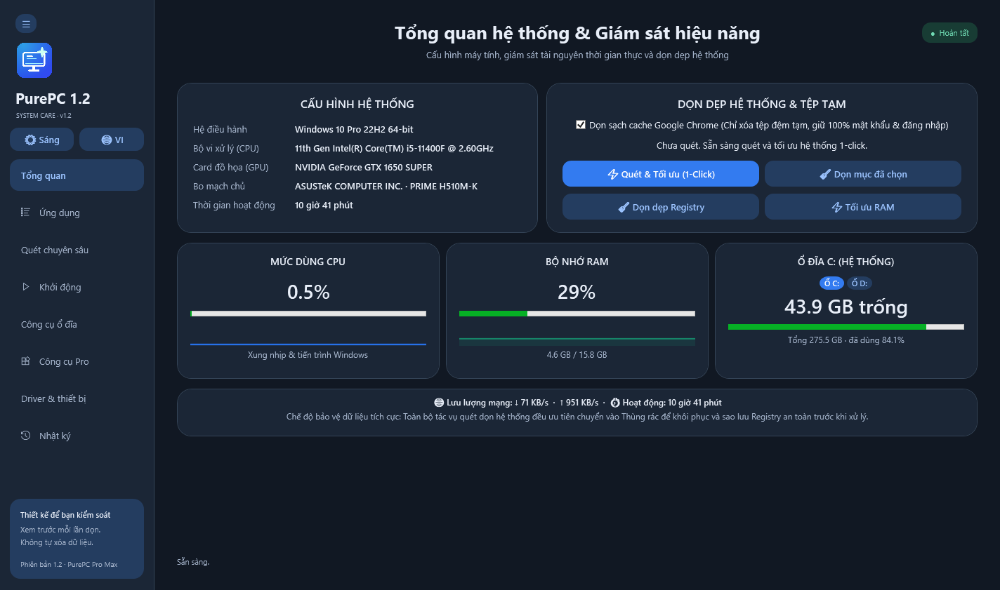
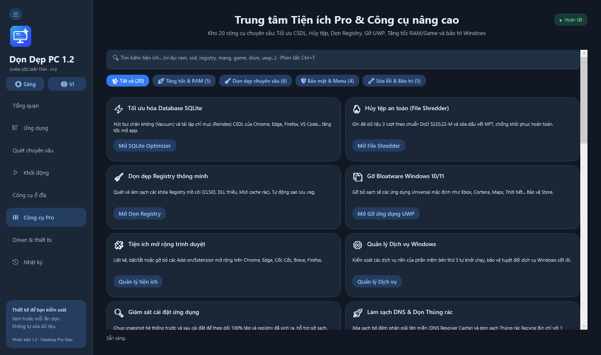
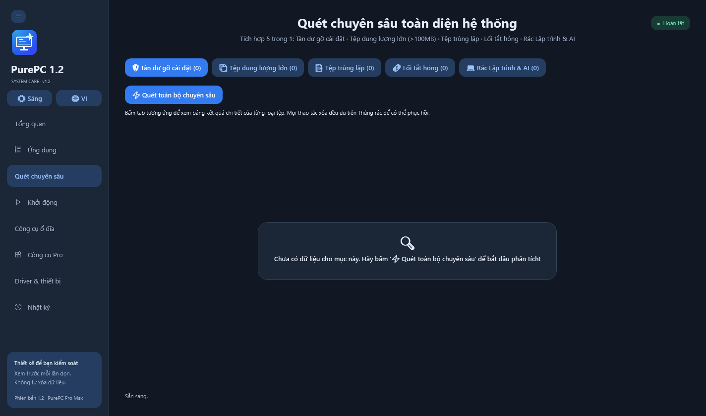
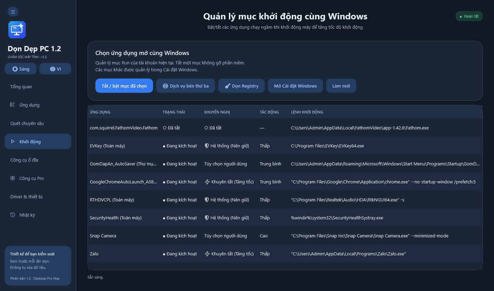

# PurePC (v1.2 Pro Max)

[](https://github.com/tiudaiza95/PurePC)
[](https://github.com/tiudaiza95/PurePC)
[](LICENSE)
[](self-test.txt)
[](Preview/)
[]()

> **PurePC** is a modern, transparent, lightweight, and bloatware-free Windows system care, deep cleaner, and performance optimization suite.  
> Combines the uninstall precision of **Revo/IObit Uninstaller**, the transparency of **BleachBit**, the deep cleaning of **CCleaner Professional**, and system tuning comparable to **ISLC & Process Lasso** — engineered in 100% native C# WPF with zero external runtime dependencies.



---

## 🚀 Key Highlights & Architectural Advantages

* **⚡ Ultra-Fast & Zero Lag**: Starts in <0.1s. Reads hardware specs in <40ms via direct Registry parsing instead of slow WMI queries.
* **🔒 100% Transparent & Safe**: Prioritizes the Windows Recycle Bin for all file deletions. Every Registry optimization automatically creates an undoable `.reg` backup in `%LOCALAPPDATA%\PurePC\Data\Registry-backups\`.
* **🧠 Working Set & Kernel Standby List Memory Purge (ISLC-grade)**: Trims process working sets via `EmptyWorkingSet` and clears kernel cached standby memory via Win32 `NtSetSystemInformation(SystemMemoryListInformation)`.
* **🎮 Game Booster & Latency Tuner**: Disables network throttling (`NetworkThrottlingIndex`), tunes TCP ACK frequency / Nagle algorithm, and activates the Windows Ultimate Performance power plan.
* **⚡ Browser SQLite Vacuum & Reindex**: Built-in native `winsqlite3.dll` engine vacuums and rebuilds database indices for Chrome, Edge, Brave, Cốc Cốc, and Firefox.
* **🔥 DoD 5220.22-M File Shredder**: 3-pass multi-pattern cryptographic data overwriting with MFT filename obfuscation for unrecoverable secure file destruction.
* **💻 Developer & AI Cache Cleaner**: First-class detection and cleaning for developer caches including `node_modules`, npm, pip, PyTorch, Hugging Face model cache, Cargo, Gradle, Docker, and Go build caches.
* **⚡ SSD TRIM & Re-TRIM Optimizer**: Direct query of NTFS/ReFS TRIM behavior and asynchronous execution of SSD cell optimization.
* **🧱 WinSxS & Component Store DISM Analyzer**: Analyzes Windows Update backups and safely reclaims gigabytes of disk space using Microsoft DISM APIs.
* **🖱️ Shell Context Menu Manager**: Disables or restores third-party Windows Explorer right-click shell extensions without corrupting registry entries.
* **🌐 Offline & Private**: Zero telemetry, zero analytics tracking, zero background ads, zero third-party bundleware.

---

## 📸 Screenshots & UI Showcase

| Dashboard & Real-time Monitor | Pro Utilities Hub (20 Tools) |
| :---: | :---: |
|  |  |

| Deep Clean (5-in-1 Engine) | Startup Manager & Recommendations |
| :---: | :---: |
|  |  |

---

## 🛠️ Module Breakdown (8 Built-in Centers)

1. **Overview (Dashboard)**: Real-time CPU, RAM, Disk, Network traffic (↓/↑), Battery health, and Uptime with smooth vector sparklines.
2. **App Manager & Uninstaller**: Dual Win32 & UWP support, batch uninstall queue, deep leftover scanner, and install snapshot tracking.
3. **Deep Clean**: 5-in-1 scanner for uninstall remnants, large files (>100MB), SHA-256 byte-by-byte duplicate detector, broken `.lnk` shortcuts, and Dev/AI caches.
4. **Startup Optimizer**: Evaluates boot impact (High/Medium/Low) with smart recommendation tags (`[🛡️ System - Keep]`, `[⚡ Recommended Disable]`, `[○ Disabled]`).
5. **Disk Care Center**: Windows Disk Cleanup, defrag/TRIM, online filesystem check (`chkdsk`), partition management, folder space visualizer, and Compact OS compression.
6. **Pro Utilities Hub**: 20 advanced utilities organized into 5 categories with real-time `Ctrl+F` search.
7. **Driver & Hardware Inventory**: Official manufacturer device auditing, hardware status, and one-click TXT driver reporting.
8. **Audit Log & History**: Full audit trail of every cleaned file, backed-up registry key, and system adjustment.

---

## ⌨️ Universal Keyboard Shortcuts

* **`Ctrl + F`**: Instant focus on Search box in Apps or Pro Tools.
* **`F5`**: Refresh real-time system metrics, process data, or scan views.
* **`Esc`**: Close modal dialogs or clear filters.
* **`Ctrl + 1` .. `Ctrl + 8`**: Rapidly jump across modules:
  * `Ctrl + 1`: Dashboard (Overview)
  * `Ctrl + 2`: Applications Manager
  * `Ctrl + 3`: Deep Clean
  * `Ctrl + 4`: Startup Optimizer
  * `Ctrl + 5`: Disk Care Center
  * `Ctrl + 6`: Pro Utilities Hub
  * `Ctrl + 7`: Driver & Hardware Inventory
  * `Ctrl + 8`: History & Logs

---

## 📥 Download & Quick Start

1. Download the latest release from the [Releases](https://github.com/tiudaiza95/PurePC/releases) page.
2. Run `PurePC.exe` directly (Single portable executable, no installer needed).

---

## 🔨 Building from Source

### Prerequisites
* Windows 10 or 11 (64-bit)
* .NET Framework 4.8 (Included in Windows 10/11)
* PowerShell 5.1+

### Compile & Verify
```powershell
# Clone the repository
git clone https://github.com/tiudaiza95/PurePC.git
cd PurePC

# Compile using native C# compiler
powershell -ExecutionPolicy Bypass -File .\Source\build.ps1

# Run the automated verification suite (145 checks)
.\PurePC.exe --self-test

# Generate updated UI screenshot previews
.\PurePC.exe --preview
```

---

<details>
<summary>🇻🇳 <b>Xem giới thiệu bằng Tiếng Việt (Bản tóm tắt)</b></summary>

### PurePC (v1.2 Pro Max) - Phần mềm Tối ưu hóa & Chăm sóc Windows Toàn diện

**PurePC** là công cụ chăm sóc, dọn dẹp hệ thống và tối ưu hóa hiệu năng máy tính Windows mã nguồn mở, hiện đại, an toàn và hoàn toàn không quảng cáo hay phần mềm rác.

#### Điểm nổi bật:
* **Khởi động tức thì (<0.1s)**, đọc trực tiếp cấu hình phần cứng không phụ thuộc WMI chậm chạp.
* **Quét dọn chuyên sâu 5 trong 1**: Tàn dư phần mềm, tệp lớn >100MB, tệp trùng khớp mã SHA-256, lối tắt hỏng và bộ nhớ đệm lập trình & mô hình AI (Python, pip, npm, PyTorch, Hugging Face...).
* **Giải phóng RAM chuyên sâu & Xóa bộ nhớ đệm Standby List cấp kernel** (tương tự ISLC).
* **Bộ tăng tốc Game**: Giảm ping, tắt bóp băng thông mạng (Nagle / Throttling) và kích hoạt Ultimate Performance.
* **20 công cụ nâng cao**: Hủy tệp an toàn DoD 5220.22-M, Tối ưu SQLite, Dọn Registry, Gỡ UWP Bloatware, Quản lý tiện ích trình duyệt, Menu chuột phải, Tối ưu TRIM SSD, Sửa lỗi hệ thống SFC / DISM...
* **Cam kết an toàn tuyệt đối**: Ưu tiên Thùng rác, tự động tạo file sao lưu Registry `.reg` trước mọi thao tác, chạy Offline 100%.

</details>

---

## 📄 License

Distributed under the [MIT License](LICENSE). Built with ❤️ for users and developers worldwide.
